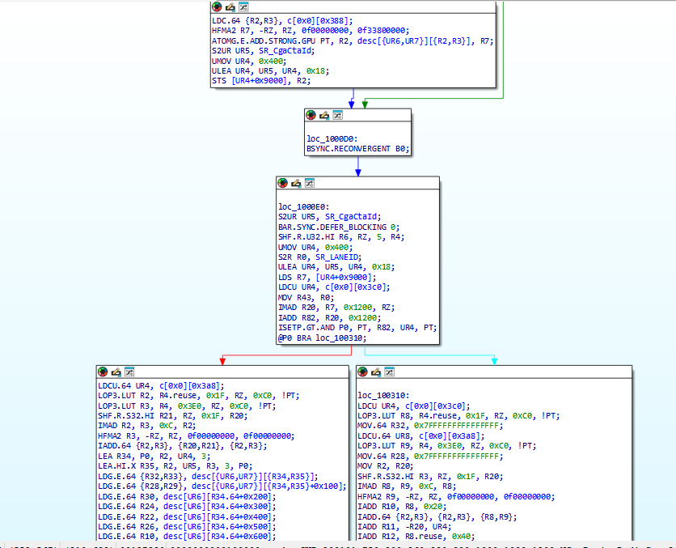
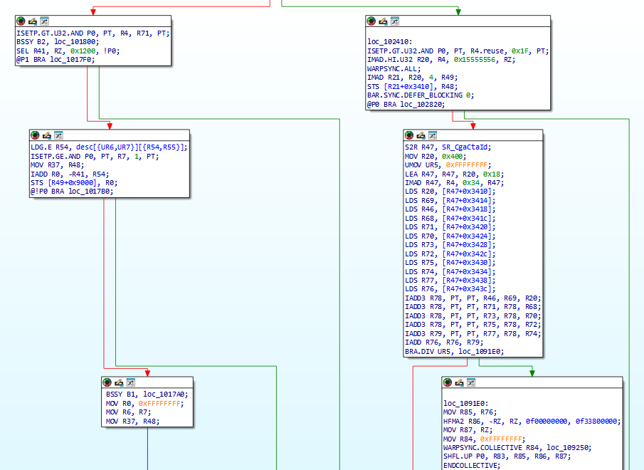

# SASS IDA Support package

Native NVIDIA SASS analysis for IDA Pro 8.4 on Windows x64.

Open CUDA cubin ELF files in IDA to inspect GPU machine instructions, registers,
operands, branches, calls, and function boundaries across multiple NVIDIA GPU
architectures.

## What you get

- A native SASS processor supporting 64-bit and 128-bit instruction formats.
- A CUDA ELF recognition plugin that selects the architecture from the file.
- Typed operands and processor metadata for analysis and IDAPython access.
- Control-flow analysis and CUDA function/helper recognition.
- `sass_defs.py` with register and instruction enums and metadata accessors.

## Supported architectures

| Instruction width | Architecture profiles |
| --- | --- |
| 64 bits | SM35, SM37, SM50, SM52, SM53, SM60, SM61, SM62 |
| 128 bits | SM70, SM72, SM75, SM80, SM86, SM87, SM89, SM90, SM100, SM101, SM103, SM107, SM110, SM120, SM121 |

Architecture `a`/`f` variants are not separate processor selections. Support for a
profile does not guarantee every undocumented instruction or modifier is covered.

## Quick start

1. Close IDA before installing or updating.
2. Extract the release package into your IDA user directory, preserving the
   `procs`, `plugins`, and `python` subdirectories. Alternatively, extract into a
   dedicated directory and set `IDAUSR` to that directory before launching IDA.
3. Start IDA Pro 8.4 and open a CUDA cubin ELF file.

For a standalone installation, extract the complete ZIP into a writable folder,
set `IDA_HOME` to your IDA Pro 8.4 installation directory (or edit
`CMD/sass_setenv.cmd`), and run `CMD/load_sass.cmd`. The launcher accepts a cubin
path and other IDA arguments, uses the extracted folder as `IDAUSR`, and writes
the IDA log to `ida-sass.log` in that folder.

See README.txt inside the ZIP for installation details and an IDAPython example.
The package does not modify the IDA installation.

## Samples

### Control-flow graph and register operands

### Branches and synchronization

## Terms of use

By downloading, installing, or using the software, you accept the terms in
[LICENSE.md](LICENSE.md). The software is for non-commercial use only.

Supported IDA version: 8.4 (Windows x64).

Author: [mr.wolf.is.me@gmail.com](mailto:mr.wolf.is.me+sass_ida@gmail.com)

